# Informe APF2 – LanReserve

## 1. Objetivo del avance

El segundo Avance de Proyecto Final (APF2) tiene como objetivo documentar y evidenciar las prácticas de colaboración, control de versiones e integración continua aplicadas durante el desarrollo de **LanReserve**, una plataforma web para la reserva de máquinas en centros de cómputo y lan centers.

Durante este avance se registra la organización del equipo mediante Git y GitHub, el uso de ramas para desarrollar funcionalidades, la creación y revisión de Pull Requests (PR) y la integración de los cambios en la rama `develop`.

Asimismo, se documenta la implementación de un flujo de integración continua mediante GitHub Actions, encargado de compilar la aplicación desarrollada con Spring Boot y Java 21, así como ejecutar las pruebas automatizadas mediante Maven y JDK 21 en el entorno de CI.

Finalmente, se presentan evidencias del trabajo colaborativo, las revisiones de código, las ejecuciones del pipeline y los errores detectados durante el proceso de integración, con el propósito de evaluar las prácticas utilizadas por el equipo y mantener un historial verificable de los cambios realizados.

## 2. Estructura del documento

El presente informe está organizado en las siguientes secciones:

- **Sección 1. Objetivo del avance:** describe la finalidad del APF2 y las actividades de colaboración e integración realizadas.
- **Sección 2. Estructura del documento:** presenta la organización del informe.
- **Sección 3. Roles y ramas del equipo:** identifica a los integrantes, sus responsabilidades, las ramas utilizadas y los Pull Requests asociados.
- **Sección 4. Estrategia de Git aplicada:** describe el modelo de ramificación, el flujo de trabajo con Pull Requests, las convenciones de commits, la integración continua, el proceso de release y hotfix, y la resolución de conflictos de fusión.
- **Sección 5. Exposición y enlace:** presenta el enlace al repositorio de LanReserve y los recursos relacionados con la exposición del avance.

## 3. Roles y ramas del equipo
| Integrante | Rol | Rama | PR | Merge |
|---|---|---|---|---|
| Samuel Torres | BD / DevOps | feature/bd-docker | #4 | 2026-09-14 |
| Samuel Torres | BD / DevOps | feature/registro-presencial | #12 | 2026-10-17 |
| Samuel Torres | BD / DevOps | chore/ci | #14 | 2026-10-18 |
| Keny Evangelista | Backend 1 | feature/auth | #1 | 2026-09-02 |
| Keny Evangelista | Backend 1 | feature/auth-completo | #7 | 2026-09-17 |
| Keny Evangelista | Backend 1 | fix/arranque-datos | #13 | 2026-10-18 |
| José Fernando Orellana | Backend 2 | feature/reservas | #2 | 2026-09-14 |
| José Fernando Orellana | Backend 2 | feature/maquina | #17 | 2026-10-18 |
| José Fernando Orellana | Backend 2 | feature/disponibilidad-controller | #18 | 2026-10-18 |
| Sebastián Quiroz | Frontend 1 | feature/frontend-cliente | #8 | 2026-10-17 |
| Sebastián Quiroz | Frontend 1 | fix/disponibilidad-render | #15 | 2026-10-18 |
| Christian Villacorta | Frontend 2 | feature/frontend-operador | #6 | 2026-10-17 |
| Christian Villacorta | Frontend 2 | feature/consola-controller | #16 | 2026-10-18 |
| Benjamin Mendez | Documentación / QA | feature/docs-flujos | #9 | 2026-10-17 |
| Benjamin Mendez | Documentación / QA | docs/informe-apf2 | #23 | (abierto) |
| Keny Evangelista | Backend 1 | feature/reserva-controller | #25 | 2026-10-19 |
| Keny Evangelista | Backend 1 | fix/consola-reservas-reales | #26 | 2026-10-21 |
| Sebastián Quiroz | Frontend 1 | feature/redesign-cliente | #27 | 2026-10-20 |
| Keny Evangelista | Backend 1 | feature/panel-administrador | #28 | 2026-10-21 |
| Keny Evangelista | Backend 1 | release/v0.2.0 | #30 | 2026-10-21 |
| Sebastián Quiroz | Frontend 1 | feature/frontend-admin-operador | #29 | 2026-10-21 |
| Samuel Torres | BD / DevOps | feature/reserva-repository | #19 | 2026-10-19 |
| Samuel Torres | BD / DevOps | docs/readme-develop | #20 | 2026-10-19 |
| Samuel Torres | BD / DevOps | hotfix/docs-readme | #24 | 2026-10-19 |
PRs cerrados sin merge: #3 (Sebastián) y #5 (Christian, con cambios solicitados).

## 4. Estrategia de Git aplicada

### 4.1 Modelo de ramas

El equipo definió su modelo en `CONTRIBUTING.md`. En la práctica se usó así:

| Rama | Función | Ejemplo real |
|---|---|---|
| main | Versión estable; solo recibe releases y hotfixes vía PR | release v0.2.0 publicado |
| develop | Integración del equipo | Recibió los PRs mergeados del avance |
| feature/* | Funcionalidad nueva | feature/maquina (PR #17) |
| fix/* | Corrección de errores | fix/arranque-datos (PR #13) |
| chore/* | Infraestructura | chore/ci (PR #14) |
| release/* | Preparar una versión | release/v0.2.0 (PR #30) |
| hotfix/* | Arreglo urgente sobre main | hotfix/docs-readme (PR #24) |

### 4.2 Flujo de trabajo
Cada integrante trabaja en su rama, abre un Pull Request hacia `develop` y
necesita la aprobación de al menos un compañero antes del merge.
- **23 PRs mergeados a `develop`** (#1, #2, #4, #6, #7, #8, #9, #12 al #20, #24 y #25 al #30), todos aprobados.
- 2 PRs cerrados sin merge: #3 y #5. El #5 recibió "Changes requested".
- Ejemplo de revisión: PR #13, aprobado por Samuel antes del merge.
- Issues enlazados a PRs: el issue #10 (registro presencial) se resolvió con el PR #12.
  Quedaron pendientes dos issues enlazados al trabajo ya hecho: #21 (módulo de reservas completo,
  relacionado con los PRs #2, #12, #18 y #19) y #22 (despliegue con Docker y CD, relacionado con
  los PRs #4 y #14).
- Se usó merge commit (en el historial figura "Merge pull request #N from ...").

### 4.3 Convención de commits
Se usan mensajes semánticos:
- `feat:` agregar entidad Reserva
- `fix:` configurar el datasource y la base en memoria para las pruebas
- `docs:` agregar flujos de casos de uso CU-05 y CU-12
- `chore:` agregar pipeline de integracion continua
- `refactor:` migrar el hash de contrasenas de SHA-256 a BCrypt

### 4.4 Integración continua
El PR #14 agregó el pipeline de GitHub Actions (`.github/workflows/build.yml`),
que compila y ejecuta las pruebas con Maven y JDK 21 (Temurin).
- Se ejecuta en cada push a `main`, `develop`, `feature/*` y `hotfix/*`.
- Se ejecuta en cada Pull Request hacia `main` o `develop`.

Evidencia (pestaña Actions, 41 ejecuciones: 40 exitosas y 1 fallida):
- La primera ejecución (build #1, PR #14) falló: la prueba `LancenterhdApplicationTests.contextLoads`
  dio el error "Failed to determine a suitable driver class" porque faltaba configurar la base
  de datos para las pruebas. Se corrigió con una base H2 de prueba y un `application.properties`
  de test. Al reabrir el PR, el build #2 pasó.
- 13 merges a develop con CI verde desde el PR #14. Los 13 push a develop ejecutaron el pipeline y finalizaron correctamente.
El PR #23 también tuvo checks verdes en cada actualización (builds #14, #15, #16, #23 y #24).
- Con check previo al merge: todos los PRs desde el #18 en adelante. Los #15, #16 y #17 se validaron
  al llegar a `develop`, porque se abrieron antes de que existiera el pipeline.

- **Resultados de las pruebas:** el proyecto cuenta con 20 pruebas automatizadas,
  todas aprobadas en la ejecución más reciente sobre `develop`:
  `UsuarioServiceTest` (7), `AdminControllerTest` (6), `OperadorControllerTest` (5),
  `ReservaRepositoryTest` (1) y `LancenterhdApplicationTests` (1).
  La captura del build #9 se conserva como evidencia de la primera ejecución del
  pipeline con 10 pruebas en verde.
  
Figura 29. Ejecución más reciente del pipeline de integración continua en develop, con 20 pruebas automatizadas aprobadas y sin fallos.

### 4.5 Release y hotfix

**Release v0.2.0.** El PR #30 (`release/v0.2.0`, "chore(release): preparar la version 0.2.0 con su changelog")
subió el `pom.xml` de `0.0.1-SNAPSHOT` a `0.2.0` y agregó el `CHANGELOG.md`. El tag `v0.2.0` marca el
commit `ef1a8ea`, el merge del PR #30 en `develop`.

- PR del release: #30
- Release publicado: https://github.com/Samuel7-A/Proyecto-HD/releases/tag/v0.2.0

**Hotfix.** La rama `hotfix/docs-readme` salió de `main` y el PR #24 ("docs: corregir README de main"),
mergeado el 2026-10-19, corrigió el `README.md` de `main`, que describía mal el stack del proyecto.

- PR del hotfix: #24

**Diferencia entre ambos:** el hotfix corrige algo urgente sobre lo ya entregado (`main`), mientras que
el release congela una versión nueva para entregar.

### 4.6 Resolución del conflicto de fusión
Al traer la rama `hotfix/docs-readme` a `docs/informe-apf2` se produjo un conflicto en
`README.md`, porque ambas ramas modificaron el archivo en paralelo: el hotfix corrigió la
descripción técnica del proyecto (Spring Boot, estructura real del repositorio y comandos de
ejecución) y esta rama actualizó la etapa a APF2 y el estado de Docker y CI/CD.

- **Archivo en conflicto:** `README.md`
- **Zonas en conflicto:** tabla de tecnologías, estructura del repositorio, "Cómo ejecutar"
  y estado del proyecto.
- **Origen:** el hotfix describe el estado de `main`, donde BD, Docker y CI figuran como
  planeados, mientras que esta rama parte de `develop`, donde el pipeline está activo y Docker configurado.
- **Decisión:** conservar ambos cambios, porque eran complementarios.
- **Resolución:** se usó "Accept Both Changes" en VS Code y se eliminaron las líneas duplicadas.
  Quedó la información técnica corregida del hotfix junto con el estado actualizado de CI/CD y
  Docker, y se unificó la versión de Java a 21.
- **Cierre:** `git add README.md` y `git commit` generaron el commit de merge `da01e5f`.
- **Documentación en el PR:** el conflicto y su resolución se describen en el PR #23 de `docs/informe-apf2` hacia `develop`.

  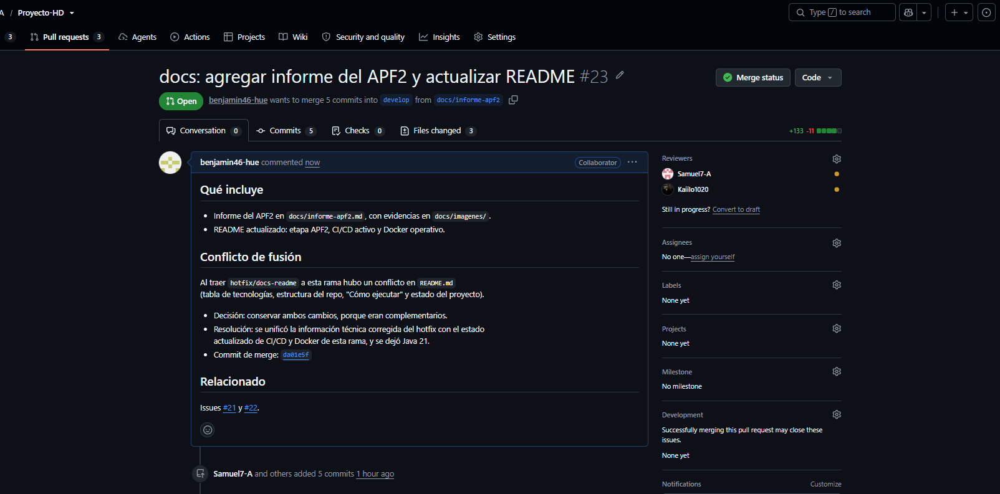

**Conflicto detectado en la terminal:**

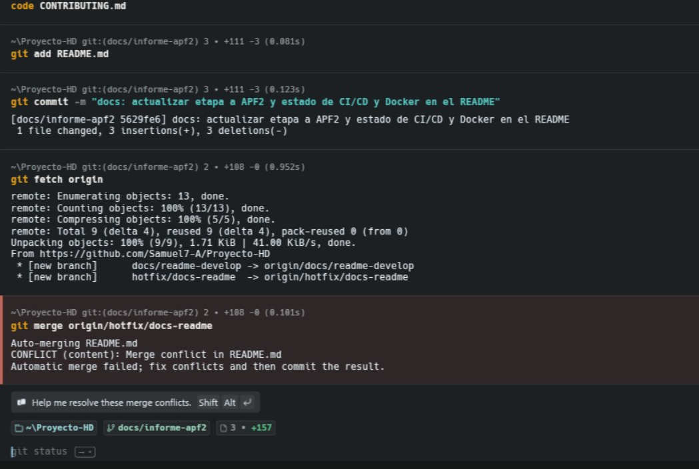

**Zonas en conflicto en el editor:**

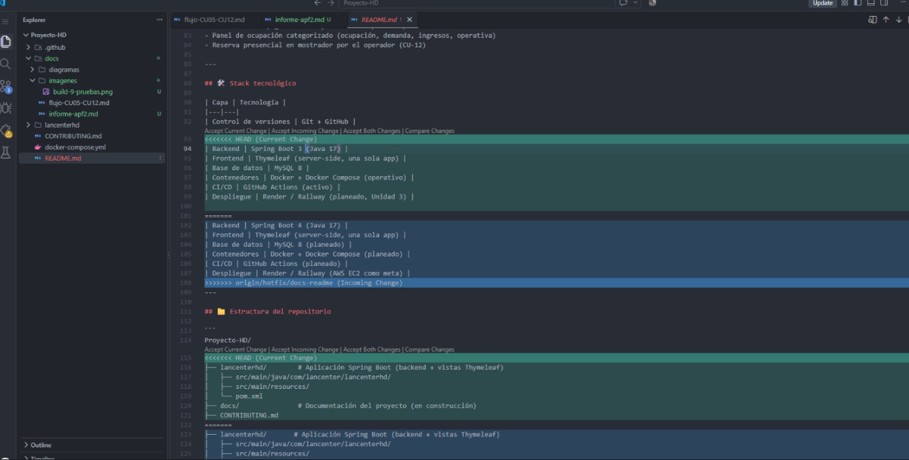

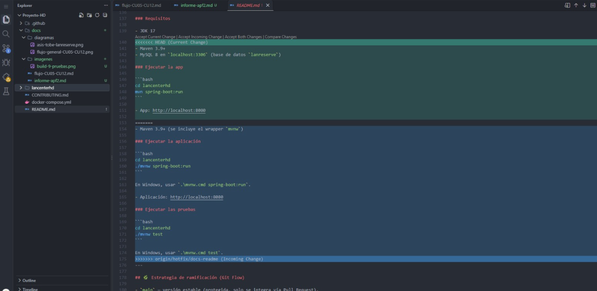

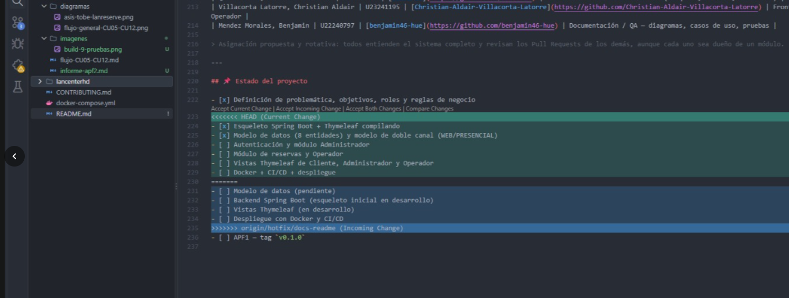

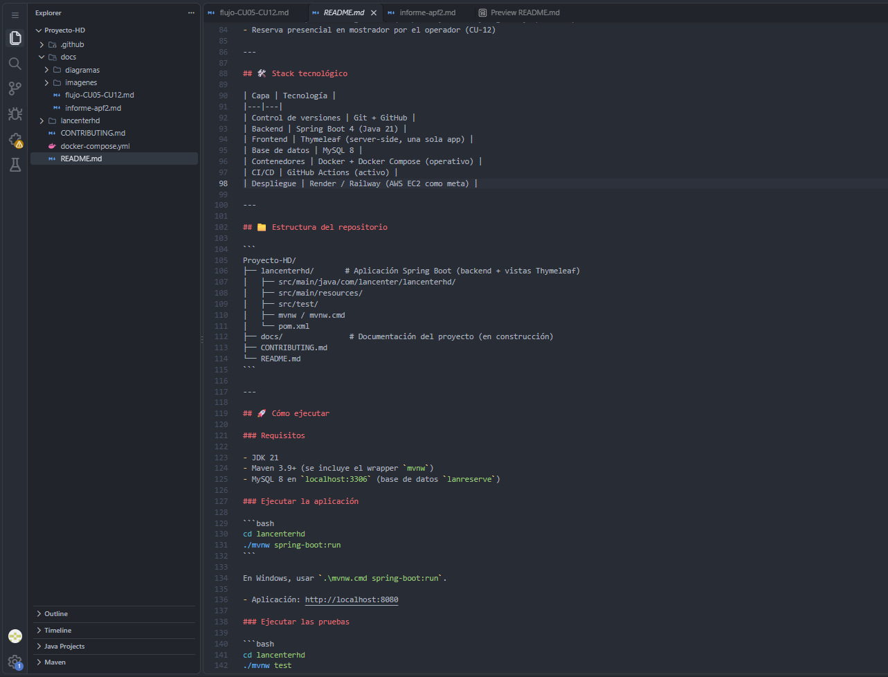

- **Segundo conflicto:** tras el merge del PR #20 a `develop`, el PR #23 volvió a entrar en
  conflicto con `README.md` en tres zonas (tabla del stack, requisitos de Maven y checklist del
  estado). Se resolvió con `git merge origin/develop` siguiendo el criterio definido en el PR:
  conservar la versión de esta rama en las dos primeras zonas y combinar ambas en el checklist.
  Commit de merge: `e2b5a87`.

  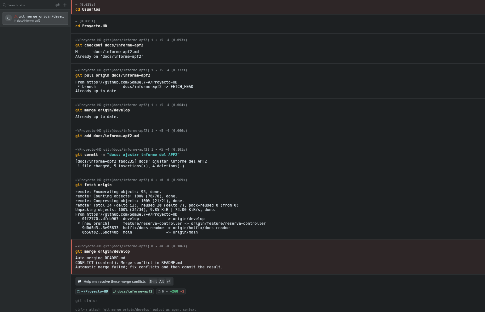

  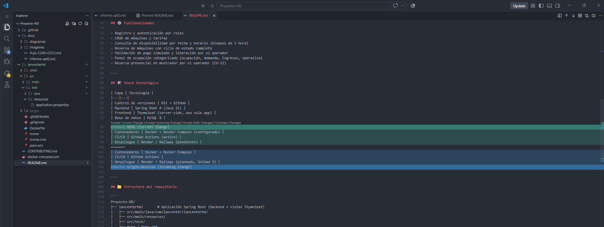

  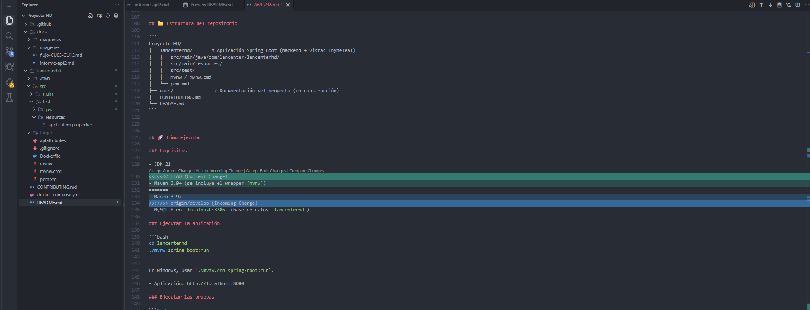

  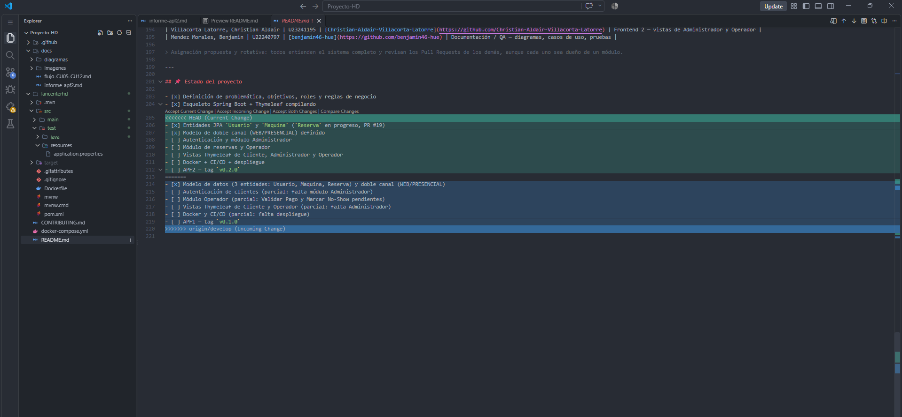

  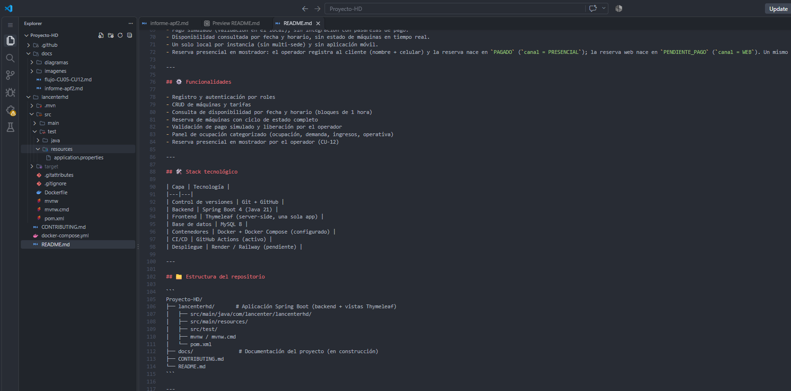

  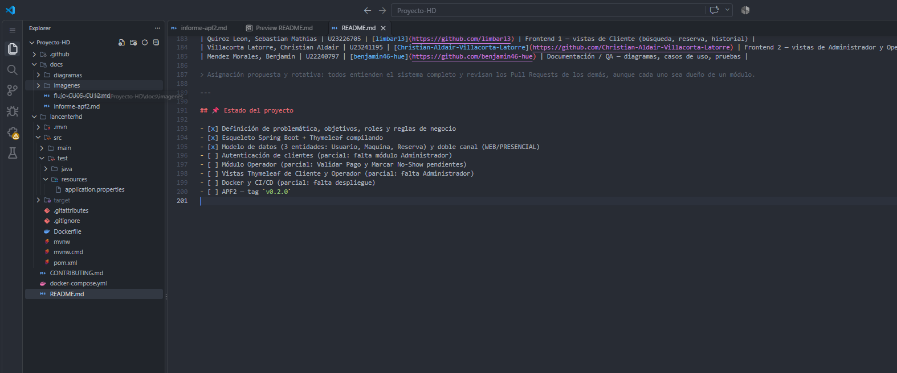

## 5. Exposición y enlace

- **Repositorio:** https://github.com/Samuel7-A/Proyecto-HD
- **Versión entregada:** v0.2.0, https://github.com/Samuel7-A/Proyecto-HD/releases/tag/v0.2.0
- **Integración continua (Actions):** https://github.com/Samuel7-A/Proyecto-HD/actions
- **PRs mergeados:** https://github.com/Samuel7-A/Proyecto-HD/pulls?q=is%3Apr+is%3Amerged

El APF2 consolidó el trabajo con ramas, Pull Requests revisados, integración continua activa,
dos conflictos de fusión documentados y la publicación del release v0.2.0.
