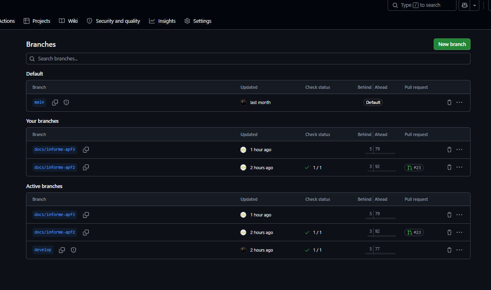
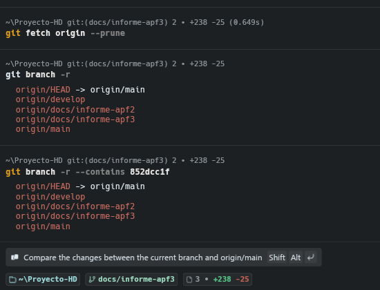
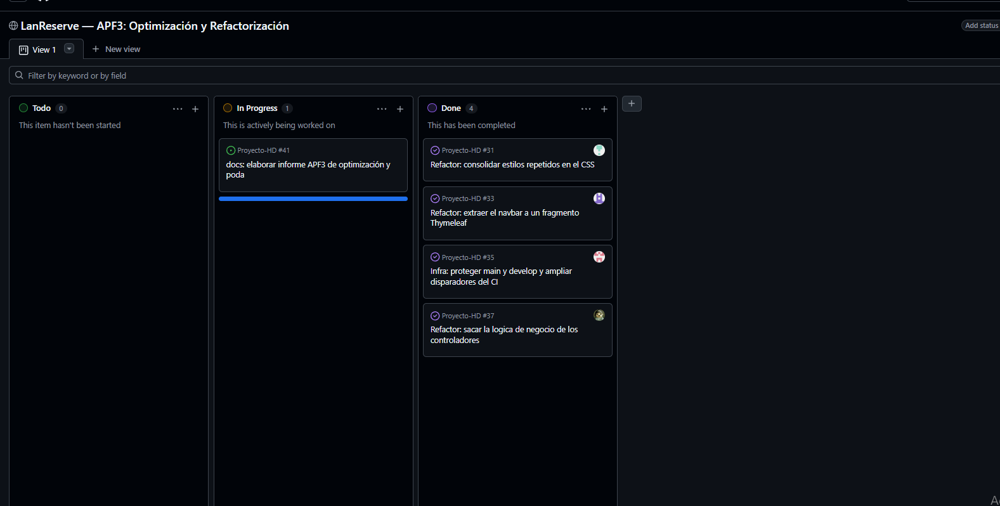

# Informe APF3 – LanReserve

## 1. Objetivo del avance

El tercer Avance de Proyecto Final (APF3) tiene como objetivo documentar la optimización y la refactorización del repositorio de **LanReserve**, y la poda de ramas que dejó el repositorio limpio y ordenado.

Se describen los criterios usados para decidir qué ramas eliminar, el procedimiento y los comandos de la poda, las verificaciones de que no se perdió ningún commit ni se rompió ningún Pull Request, y las evidencias del resultado. También se registran las refactorizaciones integradas a `develop` durante el avance.

## 2. Estado inicial del repositorio

Antes de ejecutar la poda, el repositorio de LanReserve contaba con **28 ramas remotas**, acumuladas durante el desarrollo de las funcionalidades del sistema y los anteriores avances del proyecto.

Entre ellas se encontraban ramas de funcionalidades (`feature/*`), correcciones (`fix/*`), documentación (`docs/*`), infraestructura (`infra/*`), integración y preparación de versiones (`release/*`).

Se realizó una revisión del historial de integración y de los commits asociados a cada rama, con el objetivo de identificar cuáles podían eliminarse sin afectar el código del proyecto.

### 2.1. Inventario inicial de ramas

El inventario inicial registró un total de 28 ramas remotas. De estas, 25 fueron identificadas para su eliminación y 3 para su conservación.

**Ramas conservadas:**
- `main`: rama principal del repositorio.
- `develop`: rama de integración del desarrollo.
- `docs/informe-apf2`: conservada por mantener abierto el Pull Request #23.

**Ramas identificadas para eliminación:**
- 23 ramas cuyos últimos commits estaban contenidos en `develop`.
- 1 rama `hotfix/docs-readme`, cuyo último commit estaba contenido en `main`.
- 1 rama `Rama-Secundaria`, cuyo commit `852dcc1f` estaba contenido tanto en `main` como en `develop`.

| Rama | PR asociado | Fecha de merge | Estado |
|---|---|---|---|
| feature/auth | #1 | 2026-09-02 | Eliminada |
| feature/reservas | #2 | 2026-09-14 | Eliminada |
| feature/bd-docker | #4 (reutilizada en #34) | 2026-09-14 | Eliminada |
| feature/frontend-operador | #6 | 2026-10-17 | Eliminada |
| feature/auth-completo | #7 | 2026-09-17 | Eliminada |
| feature/frontend-cliente | #8 | 2026-10-17 | Eliminada |
| feature/docs-flujos | #9 | 2026-10-17 | Eliminada |
| feature/registro-presencial | #12 | 2026-10-17 | Eliminada |
| fix/arranque-datos | #13 | 2026-10-18 | Eliminada |
| chore/ci | #14 | 2026-10-18 | Eliminada |
| fix/disponibilidad-render | #15 | 2026-10-18 | Eliminada |
| feature/consola-controller | #16 | 2026-10-18 | Eliminada |
| feature/maquina | #17 | 2026-10-18 | Eliminada |
| feature/disponibilidad-controller | #18 | 2026-10-18 | Eliminada |hotfix/docs-readme
| feature/reserva-repository | #19 | 2026-10-19 | Eliminada |
| docs/readme-develop | #20 | 2026-10-19 | Eliminada |
| feature/reserva-controller | #25 | 2026-10-19 | Eliminada |
| feature/redesign-cliente | #27 | 2026-10-20 | Eliminada |
| fix/consola-reservas-reales | #26 | 2026-10-21 | Eliminada |
| feature/panel-administrador | #28 | 2026-10-21 | Eliminada |
| feature/frontend-admin-operador | #29 | 2026-10-21 | Eliminada |
| release/v0.2.0 | #30 | 2026-10-21 | Eliminada |
| Rama-Secundaria | Sin PR | — | Eliminada |
| hotfix/docs-readme | #24 | 2026-10-19 | Eliminada |
| infra/proteccion-ramas | #36 | — | Eliminada |
| main | — | — | Conservada |
| develop | — | — | Conservada |
| docs/informe-apf2 | #23 (abierto)	| — | Conservada |

### 2.2. Verificación previa

Se verificó que las 25 ramas seleccionadas no contenían commits exclusivos fuera de las ramas principales.

Además, se comprobó que `Rama-Secundaria` apuntaba al commit `852dcc1f`, correspondiente a la creación inicial del proyecto, fechado el 26/08/2026.

La verificación permitió establecer que las referencias seleccionadas podían eliminarse sin perder los commits identificados.

**Resultado del inventario:**
- Ramas iniciales: 28.
- Ramas conservadas: 3.
- Ramas eliminadas: 25.
- Reducción neta: 89,29 %.


## 3. Criterios de poda

Una rama solo se eliminaba si cumplía estas condiciones:
- No tenía un Pull Request abierto.
- Su último commit ya estaba contenido en `develop` (o en `main`, en el caso del hotfix), es decir, no tenía commits sin integrar.
- No era una rama de integración (`main`, `develop`) ni tenía un PR pendiente de revisión (`docs/informe-apf2`, PR #23).

Primero se integraron los trabajos pendientes a `develop`, y después se verificó cada rama antes de eliminarla. 


## 4. Procedimiento de poda (comandos y verificaciones)

**Responsable:** Keny Evangelista (`Kaiilo1020`)  
**Fecha:** 17 de noviembre de 2026.

### 4.1. Sincronización e inventario

Antes de eliminar las ramas, se actualizaron las referencias remotas del repositorio:

```bash
git fetch --prune origin
```

Posteriormente, se consultó el inventario de ramas mediante GitHub CLI:

```bash
gh api "repos/Samuel7-A/Proyecto-HD/branches?per_page=100" --jq '.[].name'
```

Se identificaron 28 ramas: dos principales (`main` y `develop`), tres con Pull Requests abiertos y 23 candidatas a eliminación manual.

### 4.2. Verificación de commits y Pull Requests

Para comprobar que los commits de cada rama estaban integrados en el historial principal, se utilizó:

```bash
git merge-base --is-ancestor origin/<rama> origin/develop
git merge-base --is-ancestor origin/<rama> origin/main
```

El código de salida `0` indica que el commit evaluado es ancestro de la rama de destino; `1` indica que no lo es.

Se aplicaron tres criterios de seguridad:

- No eliminar ramas con Pull Requests abiertos.
- No eliminar ramas con commits exclusivos fuera de `main` o `develop`.
- Conservar las ramas principales `main` y `develop`.

### 4.3. Eliminación manual de ramas

La poda se realizó desde la terminal mediante el comando `git push origin --delete`, ejecutado individualmente sobre 23 ramas.

```bash
git push origin --delete Rama-Secundaria
git push origin --delete chore/ci
git push origin --delete docs/readme-develop
git push origin --delete feature/auth
git push origin --delete feature/auth-completo
git push origin --delete feature/consola-controller
git push origin --delete feature/disponibilidad-controller
git push origin --delete feature/docs-flujos
git push origin --delete feature/frontend-admin-operador
git push origin --delete feature/frontend-cliente
git push origin --delete feature/frontend-operador
git push origin --delete feature/maquina
git push origin --delete feature/panel-administrador
git push origin --delete feature/redesign-cliente
git push origin --delete feature/registro-presencial
git push origin --delete feature/reserva-controller
git push origin --delete feature/reserva-repository
git push origin --delete feature/reservas
git push origin --delete fix/arranque-datos
git push origin --delete fix/consola-reservas-reales
git push origin --delete fix/disponibilidad-render
git push origin --delete hotfix/docs-readme
git push origin --delete release/v0.2.0
```

Según el registro proporcionado por el responsable, cada comando confirmó la eliminación de la referencia remota correspondiente.

### 4.4. Eliminación automática de ramas

Las ramas `feature/bd-docker` e `infra/proteccion-ramas` fueron conservadas inicialmente debido a sus Pull Requests pendientes.

Posteriormente, se eliminaron al fusionar los PR #34 y #36, respectivamente, mediante la configuración de eliminación automática de ramas de origen de GitHub.

Con ello, el total de ramas eliminadas ascendió a 25.

### 4.5. Verificación final

La operación dejó el siguiente resultado:

| Indicador | Resultado |
|---|---:|
| Ramas iniciales | 28 |
| Eliminadas manualmente | 23 |
| Eliminadas automáticamente | 2 |
| Total eliminadas | 25 |
| Ramas conservadas | 3 |
| Reducción | 89,29 % |

Al finalizar quedaron `main`, `develop` y `docs/informe-apf2`.

Se confirmó que los commits de las ramas eliminadas estaban contenidos en las ramas principales. Además, se conservó abierto el PR #23, evitando eliminar su rama de trabajo.

Posteriormente se creó `docs/informe-apf3` para elaborar este informe, por lo que el repositorio pasó a mostrar cuatro ramas.

**Limitación de evidencia:** No se dispone de una captura de la interfaz de GitHub anterior a la poda. El inventario inicial y el procedimiento se sustentan en el registro proporcionado por el responsable, los comandos comunicados y el historial del repositorio.
## 5. Resultado de la poda

La poda del repositorio LanReserve, realizada el 17 de noviembre de 2026, permitió reducir las ramas remotas de **28 a 3**, equivalente a una disminución del **89,29 %**.

La operación se desarrolló en dos etapas: eliminación manual de ramas previamente integradas y eliminación automática de ramas después de fusionar sus Pull Requests.

### 5.1. Resumen de resultados

| Indicador | Cantidad |
|---|---:|
| Ramas iniciales | 28 |
| Ramas eliminadas manualmente | 23 |
| Ramas eliminadas automáticamente | 2 |
| **Total de ramas eliminadas** | **25** |
| **Ramas conservadas** | **3** |
| **Reducción porcentual** | **89,29 %** |

### 5.2. Conservación del historial

Antes de ejecutar las eliminaciones manuales, se comprobó que los commits de las ramas seleccionadas estaban contenidos en `develop` o `main`, utilizando `git merge-base --is-ancestor`.

Las ramas `feature/bd-docker` e `infra/proteccion-ramas` se eliminaron posteriormente al integrar los PR #34 y #36, respectivamente.

Según la verificación comunicada por el responsable, no se identificaron commits perdidos ni Pull Requests afectados por la poda.

### 5.3. Estado final del repositorio

Al finalizar la operación quedaron las ramas:

- `main`
- `develop`
- `docs/informe-apf2`

Posteriormente, se creó `docs/informe-apf3` para elaborar la documentación de este avance, aumentando temporalmente el número de ramas a cuatro.

Se confirmó además la activación de la eliminación automática de ramas fusionadas y las reglas de protección de `main` y `develop`, que requieren una revisión y la aprobación del check `build` para integrar cambios.

**Resultado:** La poda redujo las ramas innecesarias y permitió mantener un repositorio organizado, conservando las ramas principales y el trabajo pendiente de revisión.
## 6. Optimización y refactorización
### 6.1. Refactorización de estilos CSS — PR #32

**Responsable:** Sebastián (limbar13)  
**Rama:** `refactor/css-comun`  
**Estado:** Fusionado a `develop`  
**Issue relacionado:** #31

**Descripción de la mejora:**

Se realizó una refactorización de las plantillas HTML del sistema LanReserve, trasladando los estilos repetidos definidos mediante atributos `style=""` hacia clases reutilizables en el archivo `cliente.css`.

Se consolidaron los estilos correspondientes a alertas, indicadores visuales (badges), cajas decorativas y barras de progreso.

**Beneficios obtenidos:**
- Reducción de la duplicación de estilos CSS.
- Mayor facilidad para mantener y actualizar la interfaz.
- Reutilización de clases CSS en diferentes plantillas.
- Conservación de la identidad visual original del sistema.

**Validaciones realizadas:**
- Ejecución exitosa de `./mvnw test`, con 20 pruebas aprobadas.
- Verificación del funcionamiento mediante Docker en `http://localhost:8080`.
- Comparación visual antes y después de seis pantallas del sistema.
- No se modificó la lógica del backend ni la estructura del navbar.

**Resultado:** La refactorización fue integrada correctamente a la rama `develop` mediante el PR #32, sin alterar el diseño visual previsto ni la funcionalidad documentada.

### 6.2. Implementación de seguridad y navbar compartido — PR #34

**Responsable:** Samuel (Samuel7-A)  
**Estado:** Fusionado a `develop`  
**Commit de integración:** `38c737e`

**Descripción de la mejora:**

Se integró Spring Security en LanReserve para gestionar la autenticación y autorización de usuarios según sus roles: CLIENTE, OPERADOR y ADMIN.

Además, se implementó un navbar compartido mediante fragmentos Thymeleaf, permitiendo reutilizar el componente de navegación en diferentes páginas del sistema.

**Mejoras implementadas:**
- Autenticación mediante inicio y cierre de sesión.
- Protección de rutas según los roles autorizados.
- Navbar reutilizable con enlaces visibles según el usuario autenticado.
- Integración de `SesionUsuario` en los controladores de reservas, historial y consola.
- Configuración de cuentas de desarrollo bajo el perfil `dev`.

**Beneficios obtenidos:**
- Mayor control de acceso a las funcionalidades del sistema.
- Reducción de código HTML duplicado.
- Centralización del mantenimiento del navbar.
- Mejor organización y reutilización de componentes.
- Navegación adaptada al rol del usuario.

**Validaciones realizadas:**
- Pruebas `SeguridadWebTest`, `AuthFlujoTest` y `NavbarVisibilidadTest`.
- Integración con los estilos previamente refactorizados.
- Dos verificaciones de CI aprobadas.
- Revisión y aprobación de Kenny.

**Resultado:** El PR #34 fue integrado correctamente a `develop`, incorporando controles de acceso por roles y un componente de navegación compartido.
### 6.3. Optimización del pipeline CI — PR #36

**Responsable:** Samuel (Samuel7-A)  
**Rama:** `develop` (destino de integración)  
**Estado:** Fusionado  
**Issue relacionado:** #35  
**Commit de integración:** `d2872a4`

**Descripción de la mejora:**

Se optimizó el pipeline de integración continua (CI) de LanReserve mediante GitHub Actions, ampliando su ejecución a las ramas `release/*` y `fix/*`.

Además, se reemplazó el comando `mvn test` por `mvn package`, permitiendo ejecutar las pruebas y generar el archivo JAR de la aplicación durante el proceso de compilación.

**Mejoras implementadas:**
- Incorporación de las ramas `release/*` y `fix/*` a los disparadores del pipeline.
- Ejecución de `mvn package` para compilar, probar y empaquetar la aplicación.
- Publicación del archivo JAR mediante `actions/upload-artifact@v4`.
- Disponibilidad del artefacto generado para su descarga desde GitHub Actions.

**Beneficios obtenidos:**
- Mayor cobertura del proceso de integración continua.
- Automatización de la generación del archivo ejecutable.
- Disponibilidad de evidencias de compilación.
- Reducción de tareas manuales durante la preparación de entregas.

**Validaciones realizadas:**
- Revisión y aprobación del PR por Kenny.
- Verificación exitosa del pipeline CI.
- Integración del PR #36 a `develop`.

**Resultado:** Se mejoró el proceso de integración continua, incorporando la generación y publicación automática del JAR como artefacto de compilación.

**Observación:** La protección de las ramas `main` y `develop` se configura por separado en GitHub Settings; no forma parte de los cambios implementados directamente en este PR.
### 6.4. Refactorización de servicios del backend — PR #38

**Responsable:** Kenny (KennySor)  
**Rama:** `refactor/servicios-backend`  
**Estado:** Fusionado a `develop`  
**Issue relacionado:** #37  
**Commit de integración:** `a8cd4db`

**Descripción de la mejora:**

Se refactorizó el módulo de operador de LanReserve, trasladando la lógica de negocio del controlador `OperadorController` hacia un nuevo servicio denominado `OperadorService`.

Esta modificación permite separar las responsabilidades del controlador y del servicio, facilitando el mantenimiento y las pruebas del backend.

**Mejoras implementadas:**
- Creación de `OperadorService` para centralizar la lógica de negocio.
- Extracción de las consultas de nombres de clientes y códigos de máquinas.
- Centralización de las transiciones de estado de las reservas.
- Delegación del registro presencial de reservas al servicio.
- Simplificación de `OperadorController`.
- Actualización de las pruebas del controlador.
- Incorporación de 8 pruebas unitarias para `OperadorService`.

**Beneficios obtenidos:**
- Mejor separación de responsabilidades entre controlador y servicio.
- Mayor facilidad para mantener y modificar la lógica de negocio.
- Reducción de la complejidad del controlador.
- Mayor facilidad para realizar pruebas unitarias.
- Mejor organización del código backend.

**Validaciones realizadas:**
- 41 pruebas ejecutadas.
- 0 fallos y 0 errores.
- Compilación exitosa (`BUILD SUCCESS`).
- Verificación CI aprobada.
- Revisión y aprobación por Kenny (Kaiilo1020).

**Resultado:** El PR #38 fue integrado correctamente a `develop`, mejorando la organización del backend sin modificar los componentes de autenticación ni seguridad. Posteriormente, se eliminó la rama `refactor/servicios-backend`.
### 6.5. Refactorización del navbar según roles — PR #39

**Responsable:** Christian Villacorta  
**Rama:** `refactor/navbar-atributos-rol`  
**Estado:** Fusionado a `develop`  
**Issue relacionado:** #33  
**Commit:** `1ff6155`

**Descripción de la mejora:**

Se complementó la implementación del navbar compartido realizada en el PR #34, incorporando atributos globales de vista para controlar la visibilidad de los enlaces de navegación según el estado de autenticación y el rol del usuario.

**Mejoras implementadas:**
- Incorporación de los atributos `sesionActiva`, `esCliente`, `esOperador` y `esAdmin` mediante `AtributosVista`.
- Utilización de `@ModelAttribute` para compartir los atributos con las plantillas Thymeleaf.
- Actualización del fragmento `navbar.html` mediante condiciones `th:if`.
- Separación de los enlaces para usuarios autenticados y visitantes.
- Reutilización de los métodos existentes `autenticado()` y `rolActual()`.

**Beneficios obtenidos:**
- Navegación personalizada según el rol del usuario.
- Centralización de las condiciones de visualización.
- Reducción de lógica repetida en las plantillas.
- Mayor facilidad para mantener el navbar.
- Complemento de la autenticación y autorización implementadas anteriormente.

**Validaciones realizadas:**
- 33 pruebas aprobadas.
- CI exitoso en 34 segundos.
- Verificación manual con los roles CLIENTE, OPERADOR y ADMIN.
- Confirmación de que cada rol visualiza sus enlaces correspondientes.
- Sin modificaciones en CSS ni en los controladores de rutas.

**Resultado:** El PR #39 fue fusionado a `develop`, completando la adaptación del navbar compartido según los roles del sistema.

**Observación:** La visibilidad de enlaces es una mejora de interfaz que complementa, pero no sustituye, la autorización de rutas realizada mediante Spring Security.
## 7. Evidencias
### 7.1. Estado de las ramas después de la poda

Después de ejecutar la poda, el repositorio quedó con tres ramas remotas: `main`, `develop` y `docs/informe-apf2`.

Posteriormente, se creó la rama `docs/informe-apf3` para desarrollar la documentación del tercer avance.

La captura muestra las cuatro ramas presentes en el repositorio al momento de registrar la evidencia, sin que esto modifique el resultado original de la poda.


### 7.2. Verificación de conservación de commits

Se ejecutaron los siguientes comandos para actualizar las referencias remotas y comprobar la conservación del commit inicial del proyecto:

```bash
git fetch origin --prune
git branch -r
git branch -r --contains 852dcc1f
```

El resultado confirmó que el commit `852dcc1f`, anteriormente referenciado por `Rama-Secundaria`, continúa presente en las ramas `main`, `develop`, `docs/informe-apf2` y `docs/informe-apf3`.

Por lo tanto, se comprobó que dicho commit no se perdió durante la eliminación de `Rama-Secundaria`.



### 7.3. Limpieza de referencias remotas locales

Se ejecutó el comando `git fetch --prune origin` para actualizar el repositorio local y eliminar las referencias de seguimiento remoto correspondientes a ramas previamente eliminadas de GitHub.

La terminal registró 24 referencias obsoletas eliminadas. Posteriormente, `git branch -r` mostró únicamente las ramas `main`, `develop` y `docs/informe-apf2`, además de la referencia simbólica `origin/HEAD`.

Esta evidencia confirma la sincronización del repositorio local con el estado remoto después de la poda.


## 8. Tablero Kanban

Para gestionar y visualizar las actividades del APF3, se creó un tablero Kanban mediante GitHub Projects, denominado **LanReserve — APF3: Optimización y Refactorización**.

El tablero utiliza tres columnas: `Todo`, `In Progress` y `Done`, que permiten identificar las tareas pendientes, en ejecución y completadas.

Se incorporaron los siguientes issues del repositorio:

| Issue | Actividad | Estado |
|---|---|---|
| #31 | Refactorización de estilos CSS | Done |
| #33 | Refactorización del navbar | Done |
| #35 | Mejoras de infraestructura y CI | Done |
| #37 | Refactorización del backend | Done |
| #41 | Documentación del informe APF3 | In Progress |

El tablero permite centralizar el seguimiento de las actividades realizadas durante el avance y relacionarlas con los issues del repositorio.

